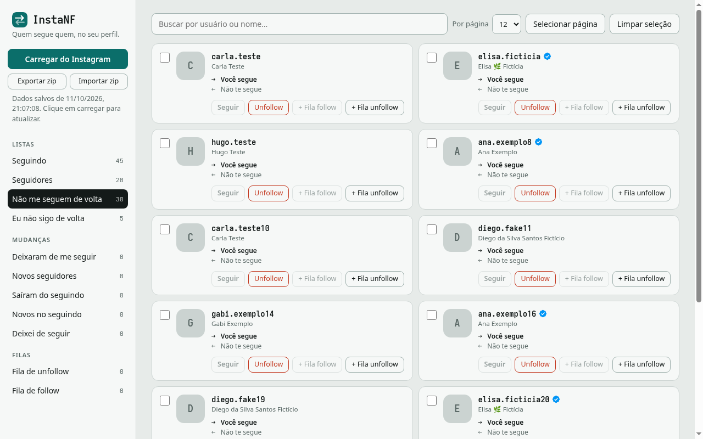

<div align="center">


# InstaNF

**Descubra quem não te segue de volta, acompanhe quem entrou e saiu, e organize seus follows e unfollows com segurança. Direto do seu navegador, sem servidor e sem senha.**




<sub>Contas da imagem são fictícias.</sub>

</div>

---

## Sumário

- [O que é](#o-que-é)
- [Recursos](#recursos)
- [Instalação](#instalação)
- [Como usar](#como-usar)
- [Guia das abas](#guia-das-abas)
- [Filas e proteção contra bloqueio](#filas-e-proteção-contra-bloqueio)
- [Exportar e importar (trocar de PC)](#exportar-e-importar-trocar-de-pc)
- [Como funciona por dentro](#como-funciona-por-dentro)
- [Privacidade e permissões](#privacidade-e-permissões)
- [Limitações e avisos](#limitações-e-avisos)
- [Problemas comuns](#problemas-comuns)
- [Estrutura do projeto](#estrutura-do-projeto)
- [Gerando uma release](#gerando-uma-release)
- [Licença](#licença)

---

## O que é

O InstaNF é uma extensão para navegadores baseados em Chromium (Chrome, Edge, Brave, Opera…) que lê a sua lista de **seguidores** e de **seguindo** no Instagram e mostra, de forma organizada:

- quem você segue mas **não te segue de volta**;
- quem te segue mas **você não segue**;
- o que **mudou** desde a última vez que você olhou (quem deixou de te seguir, quem chegou, quem saiu do seu seguindo);
- e deixa você **seguir e deixar de seguir** direto da lista, um a um ou em fila com pausas.

Ela usa a sua própria sessão do Instagram, aberta numa aba do navegador. Não existe servidor, conta, login extra nem envio de dados para lugar nenhum.

## Recursos

| | |
|---|---|
| 📋 **Listas completas** | Seguindo, seguidores, não me seguem de volta e eu não sigo de volta. |
| 🔄 **Comparação entre atualizações** | Deixaram de me seguir, novos seguidores, saíram do seguindo, novos no seguindo. |
| ✅ **Conferência de falsos alertas** | Antes de dizer que alguém saiu, a extensão confirma no Instagram. |
| 👤 **Fotos e selo de verificado** | Foto de cada pessoa e o selo azul nas contas verificadas. |
| ↔️ **Relação em cada card** | Duas linhas mostram se você segue a pessoa e se ela te segue. |
| 🚦 **Fila de unfollow e de follow** | Ações em lote com pausa aleatória entre cada uma e parada automática se o Instagram limitar. |
| ⚠️ **Ações manuais com aviso** | Botões de Seguir e Unfollow em cada card, sempre com um alerta sobre o risco de bloqueio. |
| 🔍 **Busca e paginação** | Busca por usuário ou nome, 12/24/48/96 contas por página, nomes sempre completos. |
| 📦 **Exportar e importar `.zip`** | Leve tudo para outro computador ou recupere depois de limpar o cache. |
| 📊 **CSV de cada aba** | O zip traz uma planilha por aba, para abrir no Excel ou no Google Planilhas. |
| 🌗 **Tema claro e escuro** | Segue o tema do seu sistema. Respeita "reduzir movimento". |

## Instalação

A extensão não está na Chrome Web Store. Ela é instalada em **modo desenvolvedor**, o que leva menos de um minuto.

### Opção A: baixar a versão pronta (recomendado)

1. Abra a página de **Releases** deste repositório e baixe o arquivo `instanf-vX.Y.Z.zip` da versão mais recente.
2. **Extraia** o zip. Vai aparecer uma pasta chamada `instanf`. Guarde-a num lugar fixo (não apague depois: o navegador usa a pasta, não uma cópia).
3. No navegador, abra `chrome://extensions` (no Edge: `edge://extensions`, no Brave: `brave://extensions`).
4. Ligue o **Modo do desenvolvedor** (canto superior direito).
5. Clique em **Carregar sem compactação** e selecione a pasta `instanf`.
6. (Opcional) Clique no ícone de quebra-cabeça da barra do navegador e **fixe** o InstaNF para ter o ícone sempre à mão.

### Opção B: a partir do código-fonte

```bash
git clone <url-deste-repositorio>
```

Depois siga os passos 3 a 5 acima, escolhendo a pasta clonada. Não há `npm install` nem etapa de build.

### Atualizando

Baixe a nova release, extraia por cima da pasta antiga e, em `chrome://extensions`, clique no botão de **recarregar** (seta circular) do InstaNF. Seus dados continuam salvos.

## Como usar

1. Abra o **instagram.com** em uma aba e **entre na sua conta** (a extensão trabalha na conta que estiver logada).
2. Clique no ícone do **InstaNF**. Abre uma página própria da extensão.
3. Clique em **Carregar do Instagram**. As listas aparecem aos poucos, com barra de progresso. Contas grandes levam alguns minutos porque o carregamento é feito com pausas, para não incomodar o Instagram.
4. Navegue pelas abas na barra lateral. Use a busca, a paginação e os botões de cada card.
5. Da próxima vez que abrir, os dados salvos aparecem na hora. Clique em **Carregar do Instagram** quando quiser atualizar. É aí que as abas de **Mudanças** comparam com a atualização anterior.

> A aba do Instagram precisa continuar aberta enquanto você carrega listas ou executa follow/unfollow. Ver as listas já salvas não exige isso.

## Guia das abas

### Listas

| Aba | O que mostra |
|---|---|
| **Seguindo** | Todas as contas que você segue. |
| **Seguidores** | Todas as contas que te seguem. |
| **Não me seguem de volta** | Você segue, mas a pessoa não te segue. |
| **Eu não sigo de volta** | A pessoa te segue, mas você não segue. |

### Mudanças

Estas abas dependem de pelo menos **duas** atualizações: a extensão compara a lista nova com a anterior. Na primeira carga elas ficam vazias.

| Aba | O que mostra |
|---|---|
| **Deixaram de me seguir** | Estavam entre seus seguidores e não estão mais. |
| **Novos seguidores** | Passaram a te seguir desde a última atualização. |
| **Saíram do seguindo** | Contas que saíram do seu "seguindo" por fora da extensão (por exemplo, unfollow feito no app ou conta desativada). |
| **Novos no seguindo** | Contas que você passou a seguir desde a última atualização. |
| **Deixei de seguir** | Histórico dos unfollows feitos **pela extensão**, com a data. |

Nas abas de mudanças, cada card mostra as duas linhas de relação (`→ Você segue` / `← Te segue`), o que ajuda a entender a situação atual da pessoa.

### Filas

| Aba | O que faz |
|---|---|
| **Fila de unfollow** | Lista de contas a deixar de seguir, processadas uma a uma. |
| **Fila de follow** | Lista de contas a seguir, processadas uma a uma. |

### O card de cada pessoa

```
[ ] [foto]  usuario ✔
            Nome Completo
            → Você segue
            ← Te segue
            [Seguir] [Unfollow] [+ Fila follow] [+ Fila unfollow]
```

- **Caixinha:** seleciona a conta. Com contas marcadas aparecem os botões **Enviar N p/ fila de unfollow** e **Enviar N p/ fila de follow** (quem você já segue vai para a de unfollow, quem não segue vai para a de follow). Há também **Selecionar página** e **Limpar seleção**.
- **Seguir / Unfollow:** executam na hora, depois de um aviso de cautela.
- **+ Fila follow / + Fila unfollow:** mandam só aquela pessoa para a fila.
- Os botões que não se aplicam ficam **cinza e desabilitados**: quem você já segue não pode ser seguido de novo, e quem você não segue não pode receber unfollow.

## Filas e proteção contra bloqueio

O Instagram limita quantas ações uma conta pode fazer em pouco tempo. Passou do limite, a conta fica temporariamente impedida de seguir ou deixar de seguir. Para reduzir esse risco:

- **Pausa aleatória de 15 a 30 segundos** entre uma ação e outra na fila (nunca um intervalo fixo, que parece robô).
- **Confirmação antes de iniciar** cada fila, com o número de contas e o lembrete do risco.
- **Parada imediata** se o Instagram responder com limite (`feedback_required` ou HTTP 429): a extensão não insiste em outros endereços e **trava os botões por 6 horas**. A trava fica salva no navegador.
- **Aviso em toda ação manual**, contando quantas ações você fez nos últimos 10 minutos.
- **Botão Parar** durante a execução e **Remover** nos itens que ainda estão aguardando.
- Se um item der erro, a fila para e mostra o motivo. Ao iniciar de novo, os itens com erro são tentados outra vez.

**Boas práticas:** faça lotes pequenos (20 a 30 contas), espere horas entre eles e evite passar de uns 100 por dia. A pausa mais humana ajuda, mas o que mais pesa é o **volume** na janela de tempo.

## Exportar e importar (trocar de PC)

Os dados ficam salvos no próprio navegador. Se você trocar de computador ou limpar o cache, eles somem, a não ser que tenha exportado.

- **Exportar zip** (barra lateral) baixa `instanf-AAAA-MM-DD.zip` com:
  - `dados.json`: o estado completo (seguidores, seguindo, todas as comparações, histórico de unfollows, as duas filas, data da última atualização e itens por página);
  - um **CSV por aba** (`seguindo.csv`, `nao-me-seguem-de-volta.csv`, `novos-no-seguindo.csv`…), com usuário, nome, id, verificado, "você segue", "te segue" e data. Os CSVs abrem direto no Excel, com acentos corretos.
- **Importar zip** lê o `dados.json` de um zip exportado, mostra um resumo e, depois da sua confirmação, **substitui** os dados atuais.

Detalhes que valem saber:

- As **fotos não vão no zip** (o Instagram troca os endereços delas). Reaparecem na próxima vez que você carregar do Instagram. Até lá, aparecem as iniciais.
- Para a comparação de mudanças funcionar no PC novo, **importe antes de carregar** do Instagram.
- O zip contém a sua lista de contatos. **Não compartilhe o arquivo.** Ele é ignorado pelo `.gitignore` deste repositório para não subir por acidente.
- O arquivo importado é validado: só o formato esperado é aceito e links de foto só são mantidos se forem do CDN do Instagram.

## Como funciona por dentro

### Visão geral

```
┌─────────────────────────┐   chrome.scripting      ┌──────────────────────────┐
│  Página da extensão     │ ───────────────────────▶ │  Aba do instagram.com    │
│  (app.html + app.js)    │   executeScript(func)    │  (sua sessão logada)     │
│  interface, listas,     │ ◀─────────────────────── │  fetch() com seus cookies│
│  filas, cache local     │        resultado         └────────────┬─────────────┘
└────────────┬────────────┘                                       │ API web do Instagram
             │ localStorage                                       ▼
             ▼                                        /api/v1/friendships/...
      dados no navegador
```

Não há servidor próprio. A página da extensão **injeta pequenas funções na aba do Instagram**, e essas funções fazem as requisições como se fossem o próprio site, usando a sessão que já existe. Os resultados voltam para a página da extensão, que desenha a interface.

### Passo a passo

1. **Descobrir quem você é.** O id da sua conta vem do cookie `ds_user_id`, que a própria aba do Instagram já tem.
2. **Contagens.** `GET /api/v1/users/{id}/info/` informa o total de seguidores e seguindo, usado para a barra de progresso.
3. **Listas, página por página.** `GET /api/v1/friendships/{id}/followers/` e `/following/`, 100 contas por vez, seguindo o cursor `next_max_id`, com 800 ms de pausa entre páginas. Cada página volta para a interface, por isso a lista cresce enquanto carrega.
4. **Cruzamentos.** "Não me seguem de volta" e "Eu não sigo de volta" são calculadas comparando os dois conjuntos de ids, sem nova requisição.
5. **Mudanças.** Ao terminar de carregar, a nova lista é comparada com o snapshot salvo na atualização anterior.
6. **Conferência.** A lista do Instagram às vezes omite contas. Para cada conta suspeita de "saída", a extensão consulta `GET /api/v1/friendships/show/{id}/` e descarta o alerta se a relação ainda existir (até 60 contas por carga).
7. **Seguir e deixar de seguir.** São `POST /api/v1/friendships/create/{id}/` e `.../destroy/{id}/` (com alternativa em `/api/v1/web/friendships/...`). A requisição imita a do site: corpo de formulário, token CSRF do cookie `csrftoken` e os headers de sessão que o site envia (`X-IG-App-ID`, `X-ASBD-ID`, `X-IG-WWW-Claim`, `X-Instagram-AJAX`, ids do dispositivo). Tudo isso é **lido da aba**, nada é digitado ou guardado pela extensão.

### Detalhes de implementação

- **Sem dependências.** JavaScript puro, sem build, sem `npm`. O zip é gerado e lido por código próprio (formato ZIP sem compressão na escrita; leitura aceita também deflate).
- **Fotos.** As imagens do CDN do Instagram bloqueiam o uso direto em outros sites. A extensão baixa cada foto por conta própria (permissão de acesso ao CDN), mantém 6 downloads simultâneos e exibe via `blob:`. Se falhar, mostra a inicial da conta.
- **Cache.** Tudo é salvo no `localStorage` da página da extensão (~5 MB, suficiente para milhares de contas). A trava de bloqueio fica numa chave separada.
- **Textos com acento.** Nomes que cheguem com codificação trocada (`João`) são corrigidos na exibição, sem alterar nomes já corretos.
- **Interface.** Cards em duas colunas para os nomes caberem inteiros, animações curtas (até 220 ms) só ao trocar de aba ou página, foco visível por teclado, rótulos de acessibilidade e `prefers-reduced-motion` respeitado.

## Privacidade e permissões

- **Nada sai do seu computador.** Não há servidor, telemetria, analytics nem terceiros. As únicas conexões são as da extensão com o próprio Instagram, pela sua aba.
- **Sem senha.** A extensão nunca pede nem vê sua senha. Ela usa a sessão que já está aberta no navegador.
- **Dados locais.** Listas e histórico ficam no armazenamento do navegador, e só saem se **você** exportar o zip.

Permissões do `manifest.json`:

| Permissão | Para que serve |
|---|---|
| `scripting` | Rodar as funções de leitura e ação dentro da aba do Instagram. |
| `https://www.instagram.com/*` | Acessar a aba do Instagram e a API do site. |
| `https://*.cdninstagram.com/*`, `https://*.fbcdn.net/*` | Baixar as fotos de perfil do CDN. |

## Limitações e avisos

> **Projeto independente, sem vínculo com o Instagram ou a Meta.** Use por sua conta e risco.

- A extensão usa a **API interna do site**, que não é pública nem documentada. O Instagram pode mudar endereços e formatos **a qualquer momento**, e nesse caso partes da extensão deixam de funcionar até serem ajustadas.
- Seguir e deixar de seguir de forma automatizada pode ir contra os **Termos de Uso** do Instagram e pode levar a **bloqueios temporários**. Os limites da extensão ajudam, mas **não garantem** que nada aconteça.
- Contas **privadas** recebem uma *solicitação* de follow em vez de um follow imediato. A extensão trata isso como pendente e não coloca a conta no seu "seguindo" até a aprovação.
- O carregamento é lento de propósito (pausas entre páginas). Contas com dezenas de milhares de contatos podem levar bastante tempo e passar do limite de armazenamento do `localStorage` (~5 MB). Nesse caso o salvamento falha sem avisar e a página volta a funcionar sem cache.
- Funciona em navegadores Chromium. Firefox e Safari não foram testados.

## Problemas comuns

| Sintoma | O que fazer |
|---|---|
| "Abra o instagram.com (logado) em outra aba" | Abra o Instagram e entre na conta. Deixe a aba aberta. |
| "Não logado no Instagram" | A sessão expirou. Entre de novo no Instagram e tente outra vez. |
| Erro HTTP 4xx ao carregar | Aguarde alguns minutos (pode ser limite de requisições) e tente de novo. |
| Mensagem `feedback_required` / "Tente novamente mais tarde" | O Instagram limitou as ações da conta. Espere horas, faça lotes menores. A extensão trava os botões por 6 horas. |
| "Resposta HTML: endpoint recusado" ao seguir/deixar de seguir | O Instagram recusou a requisição. Pode ser mudança no site ou bloqueio. Recarregue a aba do Instagram e tente depois. |
| Fotos aparecem só como iniciais | As fotos expiram. Clique em **Carregar do Instagram** para renovar. |
| Abas de mudanças vazias | Elas precisam de duas atualizações. Carregue de novo depois de um tempo. |
| Perdi tudo ao trocar de PC | Use **Exportar zip** no PC antigo e **Importar zip** no novo, antes de carregar do Instagram. |

## Estrutura do projeto

```
.
├── manifest.json        # Manifest V3: permissões, ícones, ação da barra
├── background.js        # Service worker: abre a página da extensão ao clicar no ícone
├── app.html             # Interface (HTML + CSS)
├── app.js               # Toda a lógica: coleta, listas, filas, zip, cache
├── icons/               # Logo (SVG) e ícones PNG 16/32/48/128
├── docs/screenshot.png  # Imagem do README (contas fictícias)
├── .github/workflows/
│   └── release.yml      # Gera o zip instalável e publica a Release
├── LICENSE              # MIT
└── README.md
```

## Gerando uma release

O workflow `.github/workflows/release.yml` empacota a extensão e publica a Release automaticamente:

1. Atualize o campo `version` do `manifest.json` (por exemplo, `2.1.0`) e faça o commit.
2. Crie e envie a tag correspondente (com o prefixo `v`):

   ```bash
   git tag v2.1.0
   git push origin v2.1.0
   ```

3. O GitHub Actions confere se a tag bate com a versão do manifest, monta o `instanf-v2.1.0.zip` (com a pasta `instanf/` dentro) e cria a Release com o zip anexado e as notas geradas automaticamente.

Para só testar o empacotamento sem publicar, rode o workflow manualmente na aba **Actions** (*Run workflow*): o zip fica disponível como artefato.

## Licença

Distribuído sob a licença **MIT**. Veja o arquivo [LICENSE](LICENSE).
